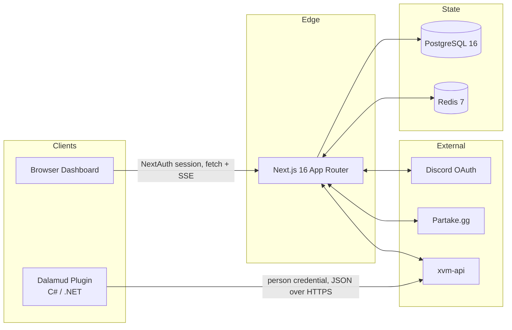

# Architecture

> Companion to [CASE_STUDY.md](../../CASE_STUDY.md). The case study summarizes; this doc walks the actual implementation.

## System overview

Two clients (FFXIV game plugin, web browser) talk to one Next.js application backed by Postgres and Redis. Single-region, single-replica, self-hosted on Linux + Docker Compose.



## Repository layout

```
xiv-app/
├── app/                          # Next.js App Router
│   ├── api/
│   │   ├── auth/[...nextauth]/   # NextAuth catch-all (wrapped with rate limit)
│   │   ├── plugin/               # Plugin account link: pairing codes and credentials (session auth)
│   │   ├── venues/               # Dashboard API (43 routes, session auth)
│   │   ├── admin/                # Admin-only routes
│   │   ├── stream/[venueId]/     # SSE endpoint for live page
│   │   └── ...
│   ├── dashboard/                # Browser dashboard pages
│   ├── auth/                     # Sign-in / error pages
│   └── invite/                   # Invitation accept flow
├── components/                   # React components (shadcn/ui based)
├── lib/
│   ├── api/                      # Server-side helpers (xvm-api client, venue-access, plugin-auth's checkPermission)
│   ├── middleware/               # withRateLimit, withVenueAuth
│   ├── sse/                      # In-process event bus for live updates
│   ├── auth.ts                   # NextAuth options
│   ├── prisma.ts                 # Shared PrismaClient singleton
│   ├── redis.ts                  # Shared ioredis singleton
│   ├── rate-limit.ts             # Sliding-window limiter (uses lib/redis)
│   └── redis-cache.ts            # Cache-aside layer (uses lib/redis)
├── prisma/schema.prisma          # 19 models
└── docker-compose.yml            # web + postgres + redis + xiv-stats + adminer + static-ehno
```

## Data model summary

19 Prisma models. The five anchors:

| Model           | Role                                                                                           |
| --------------- | ---------------------------------------------------------------------------------------------- |
| `User`          | Account identity (Discord-linked via NextAuth `Account`)                                       |
| `UserCharacter` | Maps an FFXIV character (name + world) to a user. One user can have many characters.           |
| `Venue`         | The tenant boundary. Almost everything else has `venueId`.                                     |
| `Membership`    | Many-to-many between User and Venue, with role + status. The fundamental authorization record. |
| `ApiKey`        | Legacy plugin keys, no longer read. The plugin now holds an xvm-api credential.                |

Auxiliary models layer on top: `Event`, `Shift`, `PatronLog`, `Transaction`, `Service`, `Role`, `Task`, `PayrollEntry`, `Webhook`, `Feedback`, `EventTemplate`, plus NextAuth's `Session` and `VerificationToken`.

## Authentication: two surfaces, two strategies

The plugin and browser have different threat models, so they use different auth.

### Browser: NextAuth + Discord OAuth

- All dashboard routes are session-protected via `getServerSession(authOptions)`
- Sessions are JWT-strategy, 7-day max age, refreshed every 24 hours
- The whole `/api/auth/[...nextauth]` catch-all is wrapped to throttle `signin` and `callback` paths to 10/min/IP. Polled paths (`/session`, `/csrf`) are exempt because the NextAuth client polls them aggressively for legit refresh.

### Plugin: linked xvm-api credential

- The plugin calls xvm-api directly. It does not go through this application
- A signed-in user mints a pairing code (`/api/plugin/pairing-codes`) and the plugin redeems it with xvm-api for its own credential
- The dashboard only lists and revokes those credentials (`/api/plugin/credentials`), under session auth
- The old `vm_<nanoid>` keys, `x-api-key` header, per-IP and per-key plugin rate limits are gone; the history is in [security.md](./security.md)

## The plugin contract

The plugin talks to xvm-api, so the plugin-facing HTTP surface is xvm-api's, published as its `contract/openapi.json`. This application serves the plugin only the account link under `/api/plugin/*` (pairing codes and credentials).

## Patron visits

Patron visits are logged by the plugin straight to xvm-api, which owns dedupe, working-versus-patron classification and event attribution. This application no longer receives them.

## Real-time delivery: SSE

The live page (`/dashboard/<venue>/live`) shows arrivals as they happen. Implementation:

- `lib/sse/venue-events.ts` exposes a per-process `EventEmitter` keyed by `venueId`
- Routes that change live state (logging a sale, setting a room's status) call `venueEventBus.emit(venueId, event)`
- `/api/stream/[venueId]/route.ts` opens a long-lived `text/event-stream` response, attaches a listener, writes events as `data: {...}\n\n`
- Browser uses the native `EventSource` API; no client library

Trade-offs:

- **In-process bus is single-replica.** Multi-replica web tier would need Redis pub/sub. Pre-provisioned (Redis is already there), so it's a 50-line swap when needed.
- **Connections drop on server restart.** Browser auto-reconnects. For sub-second blips this is acceptable; for chat it would not be.

## Caching layer

`lib/redis-cache.ts` uses the shared ioredis singleton. Six routes use it (cache-aside via `getOrSet`):

- `GET /api/venues` (a user's venues)
- `GET /api/venues/[venueId]`
- `GET /api/venues/[venueId]/services` + `[serviceId]`
- `GET /api/venues/[venueId]/transactions/[transactionId]`
- `lib/api/transactions.ts` (helper)

TTLs (`cacheTTL` in `lib/redis-cache.ts`):

- Venues: 5 min
- Venue settings: 10 min
- Memberships: 5 min
- Services: 10 min (low churn)
- Transactions: 3 min (higher churn)

Invalidation is explicit in mutating routes. `invalidateCache(cacheKeys.userVenues(userId))` runs after venue create/delete, etc.

## Production deployment

- Single Linux box, `docker compose up -d`
- 6 containers: `venue-manager` (Next.js standalone), `postgres`, `redis`, `xiv-stats` (homepage stats API), `adminer` (DB admin UI, internal only), `static-ehno` (nginx, ehno.xivvenuemanager.com)
- Reverse proxy fronts the public URL (`xivvenuemanager.com`) and terminates TLS
- GitHub Actions runs lint + `npm audit --audit-level=high` on push and weekly cron
- Deploys are manual: SSH to server, `git pull`, `docker compose build venue-manager && docker compose up -d venue-manager`. Solo project; full continuous deployment isn't worth its failure modes when I'm the only shipper.

For the security model layered on this architecture, see [security.md](./security.md). For scaling considerations, see [scaling.md](./scaling.md).
